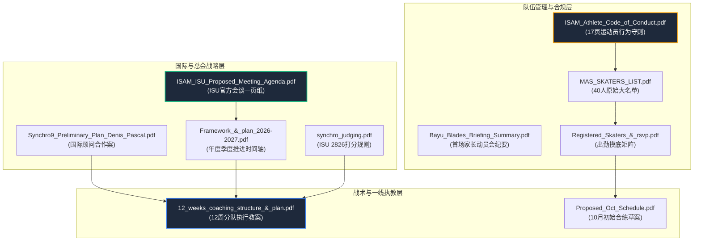

# MAS Synchro9 核心文件深度上下文导读 (Documents Context Brief)

**生成时间**: 2026-10-15  
**文档目标**: 为 **Coach Cheng Wei (Wallance)** 提供 10 份下载归档文件的全景背景解析。本手册不仅说明“文件写了什么”，更揭示“为什么发这份文件”、“背后的博弈与人事潜台词”，以及“对教练组今晚会议的实质指导意义”。

---

## 目录索引与全景脉络图

---

## 一、 执教与训练技术文件

### 1. [`12 weeks coaching structure & plan.pdf`](file:///Users/wallypoly/Shared_AI_Memory/09_workspaces/synchro%209/documents/12%20weeks%20coaching%20structure%20&%20plan.pdf)
- **文件定位**：一线教练团队的核心执行教案（718 kB）。
- **文本核心内容**：
  - 规划了 12 周进阶训练框架（Week 1–12）。
  - 将 40 名选手拆分为 **Team 1&2**（4:00–5:00 PM）与 **Team 3&4**（5:00–6:00 PM）两批次轮转。
  - 课程模式：MYNISS 陆上体能与舞蹈（PT & Dance Off-ice）+ Sunway 冰上技术课（10:00–11:00 PM）。
- **幕后 Context（人事潜台词与真实博弈）**：
  - **起草背景**：由 Shaz 领队主导制定，专供 Michelle、ZZ 和你（Cheng Wei）讨论使用。
  - **今晚 10pm 会议的核心抓手**：教案名义上印着 Michelle & ZZ 主带，但因 Michelle 即将去印尼参赛（10/25–11/2）且周日无法固定执教，这份教案中**周日落地的实际执教主力将是你和 Shaz**。你需在今晚重点认领其中的 PT/陆上体能与动作模块。

---

### 2. [`Framework & plan 2026-2027.pdf`](file:///Users/wallypoly/Shared_AI_Memory/09_workspaces/synchro%209/documents/Framework%20&%20plan%202026-2027.pdf)
- **文件定位**：总会向国家体育理事会（MSN）与高层汇报的宏观年度规划（101 kB）。
- **文本核心内容**：
  - **Q1（10–12月，12周）**：基础摸底（10月 40人）$\rightarrow$ 队伍集训营（11月）$\rightarrow$ 选拔 20 人（12月：10 名青年组 + 10 名成年组）。
  - **Q2（1–3月）**：国家代表队成军，开始进入 2027 东运会（SEA Games）正式节目的成套编排与动作定型。
- **幕后 Context**：
  - **阻击草率选拔的盾牌**：总会管理层原打算 10 月底就草率选人，Shaz 拿出这个框架说服总会：同步滑冰需要团队默契，必须跑满第一季度的摸底期，才能在 11 月底做科学选拔。

---

### 3. [`Proposed Oct Schedule.pdf`](file:///Users/wallypoly/Shared_AI_Memory/09_workspaces/synchro%209/documents/Proposed%20Oct%20Schedule.pdf)
- **文件定位**：10 月合练初版排期示意单（79 kB）。
- **文本核心内容**：
  - 标注每周日 4:00–6:00 PM 在 MYNISS 开展陆上体能与冰上结合训练。
- **幕后 Context**：
  - 属于过渡性质草案，目前已演进为群公告正式确定的“10/18、10/25、11/1 MYNISS 4-6pm”执行方案。

---

## 二、 国际滑联 (ISU) 与专家合作文件

### 4. [`ISAM_ISU_Synchro9_Proposed_Meeting_Agenda_OnePager.pdf`](file:///Users/wallypoly/Shared_AI_Memory/09_workspaces/synchro%209/documents/ISAM_ISU_Synchro9_Proposed_Meeting_Agenda_OnePager.pdf)
- **文件定位**：总会（ISAM）与国际滑联（ISU）高层官方谈判的一页纸纲领（92 kB）。
- **文本核心内容**：
  - 8 大议程：东运会技术规程、派 2 名代表赴英国 Nottingham27 观摩赛事运营、**向 ISU 申请引进全职外教/技术专家常驻大马指导并带教本土教练**、裁判培训班、东运会后举办国际公开赛。
- **幕后 Context**：
  - **高层最新动态**：就在今天（10月15日）下午 16:30，总会长 Uncle Billy 与秘书长带着这份议程与 ISU 官员（Nina、Yihuan）进行了视频会谈。总会正在争取国际滑联官方资金与外教资源，旨在长效带教以你为代表的本土教练团队。

---

### 5. [`Synchro9 Preliminary Plan_Coach Denis Pascal.pdf`](file:///Users/wallypoly/Shared_AI_Memory/09_workspaces/synchro%209/documents/Synchro9%20Preliminary%20Plan_Coach%20Denis%20Pascal.pdf)
- **文件定位**：总会向国际顶级同步滑冰专家 Pascal Denis 发出的正式合作邀请书（439 kB）。
- **文本核心内容**：
  - 回顾了 2026 年 8 月马来西亚参加布达佩斯集训营的合作基础。
  - 明确总会已有本土教练组，邀请 Pascal 担任技术顾问，负责节目编排方向与关键技术指导。
- **幕后 Context**：
  - 秘书长 Azrina 在群里透露：“总会目前还欠 Pascal 一份完善的 12 个月正式训练计划”。今晚教练会议敲定的训练细节，将成为补全该计划的核心内容。

---

### 6. [`synchro judging.pdf`](file:///Users/wallypoly/Shared_AI_Memory/09_workspaces/synchro%209/documents/synchro%20judging.pdf)
- **文件定位**：国际滑联针对 Synchro9 设立的裁判标准与扣分规则法典（280 kB）。
- **文本核心内容**：
  - ISU 官方第 2826 号通告：详列 9 人制同步滑冰的技术动作分值表、裁判扣分项（跌倒、碰擦、脱手、托举超温等）。
- **幕后 Context**：
  - 单人滑教练对同步滑冰的“多人群体扣分红线”缺乏敏感度。Shaz 分享此文件，提醒全体教练在设计陆上托举和冰上推冰动作时，从第一天起就必须按 ISU 扣分红线进行规范化执教。

---

## 三、 队员招募、合规与考勤摸底文件

### 7. [`ISAM_National_Synchro9_Athlete_Code_of_Conduct.pdf`](file:///Users/wallypoly/Shared_AI_Memory/09_workspaces/synchro%209/documents/ISAM_National_Synchro9_Athlete_Code_of_Conduct.pdf)
- **文件定位**：面向所有选手与家长的法律/纪律约束协议（17页，326 kB）。
- **文本核心内容**：
  - 涵盖训练出席率硬性要求、道德风尚、社交媒体言论禁令、反兴奋剂（Anti-doping）、纠纷仲裁机制及家长承诺书。
- **幕后 Context**：
  - **选拔的行政门槛**：Shaz 在大群要求必须签署并电邮回传总会。40 人中目前有 31 人已签署回传，未签署的 9 人基本被默认为放弃资格。这份文件确立了总会对家长的管理主导权。

---

### 8. [`Bayu Blades Synchro9 Briefing Summary.pdf`](file:///Users/wallypoly/Shared_AI_Memory/09_workspaces/synchro%209/documents/Bayu%20Blades%20Synchro9%20Briefing%20Summary.pdf)
- **文件定位**：9月27日首次家长与选手动员宣讲会的纪要总结（99 kB）。
- **文本核心内容**：
  - 核心定义：*“Synchro9 is not nine individual skaters sharing the ice. It is nine athletes functioning as one synchronized unit”*（同步滑冰不是 9 个人在同一个冰面上滑单人，而是 9 个人合为一体）。
- **幕后 Context**：
  - 破除家长的“个人中心”惯性。马来西亚单人滑选手家长习惯了单人排课，这份文件强调“一人缺席，全队无法练习托举与编排”，强化集体纪律意识。

---

### 9. [`MAS SYNCHRO9 TEAM SKATERS LIST.pdf`](file:///Users/wallypoly/Shared_AI_Memory/09_workspaces/synchro%209/documents/MAS%20SYNCHRO9%20TEAM%20SKATERS%20LIST.pdf)
- **文件定位**：国家队公开招募报名的原始 40 人花名册（99 kB）。
- **文本核心内容**：
  - 涵盖报名参加 2027 东运会选拔的 40 位单人滑选手姓名。
- **幕后 Context**：
  - 总会的基础选手库。Shaz 今天在群里急寻联系电话的两位失联队员（**Suffiyah Qistina** 与 **Lim Shi Xuan**），名字就在这份底册中，但总会缺少其家长的直接联系渠道。

---

### 10. [`Registered Skaters & rsvp.pdf`](file:///Users/wallypoly/Shared_AI_Memory/09_workspaces/synchro%209/documents/Registered%20Skaters%20&%20rsvp.pdf)
- **文件定位**：40 位选手的 10 月各场次 RSVP 考勤摸底矩阵（76 kB）。
- **文本核心内容**：
  - 10月18日（周日）：15 人可出席。
  - 10月25日（周日）：21 人可出席。
  - 10月31日（周六）：仅 8 人可出席。
- **幕后 Context**：
  - **触发改期的直接证据**：正是因为这份矩阵暴露出 10月31日（周六）出席率极其惨淡（仅8人），Shaz 才在大群发起投票将训练挪到 **11月1日（周日）**。

---

## 四、 今晚 10:00 PM 教练会议行动指南

在今晚的线上会议中，建议重点抓取以下决策项：
1. **核对 [`12 weeks coaching structure & plan.pdf`](file:///Users/wallypoly/Shared_AI_Memory/09_workspaces/synchro%209/documents/12%20weeks%20coaching%20structure%20&%20plan.pdf)** 中的陆上体能（PT）模块，确认由你主导的课时内容；
2. **落实 Michelle 缺席期间（10/25–11/2）**，你与 Shaz、ZZ 的具体上冰分工与交接机制；
3. **确认 Sunway 平日冰面方案**：跟进总会对于 RM 1,200 全场包租方案（允许你上冰）的最终审批意见。
